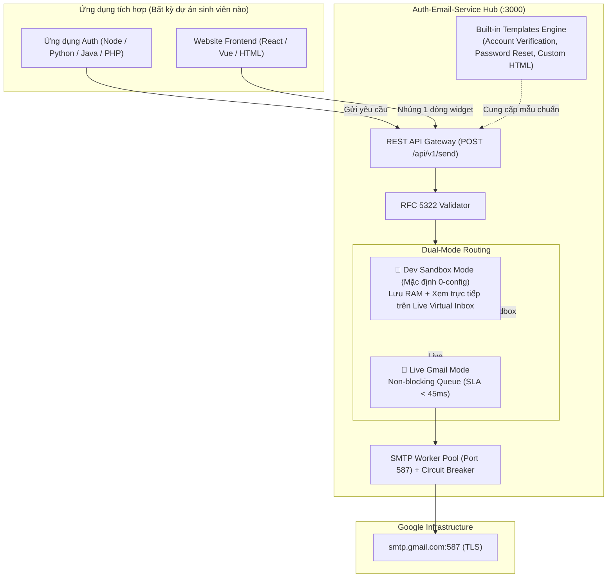

# BẢN ĐỀ XUẤT NỘI DUNG THUYẾT TRÌNH SEMINAR (SEMINAR PROPOSAL)
**HỌC PHẦN: KIẾN TRÚC HƯỚNG DỊCH VỤ (SOA)**  
**KHOA CÔNG NGHỆ THÔNG TIN – TRƯỜNG ĐẠI HỌC TÔN ĐỨC THẮNG**

---

* **Đề tài chính thức:** **Email Service Integration (Gmail SMTP)**
  * **Trọng tâm ứng dụng:**
    1. Xác thực tài khoản (*Account Verification*)
    2. Đặt lại mật khẩu (*Password Reset*)
    3. Thư điện tử định dạng đồ họa (*HTML Email*)
* **Nhóm thực hiện:**
  * **Nguyễn Thành** (Nhóm trưởng – Core Backend Architecture & Resiliency)
  * **Đức** (Thành viên – Event-Driven, Inbound IMAP & Client Integration)
  * **Đạt** (Thành viên – Dashboard UI, Demo Web App & Slide Lead)
* **Thời lượng thuyết trình dự kiến:** 20 – 25 phút (Dưới 30 phút theo quy định).
* **Mã nguồn dự án:** [https://github.com/nhduck/Auth-Email-Service.git](https://github.com/nhduck/Auth-Email-Service.git)

---

## I. TỔNG QUAN ĐỀ TÀI & CÁC CÂU HỎI CỐT LÕI (WHAT - WHY - HOW)
*(Bám sát Tiêu chí 1, 2, 3 trong Rubric đánh giá)*

### 1. WHAT – Công nghệ & Khái niệm cốt lõi (1.5 điểm)
* **Khái niệm SMTP (Simple Mail Transfer Protocol):** Giao thức chuẩn mạng Internet (RFC 5321) truyền tải thư điện tử ở tầng ứng dụng (Application Layer), vận hành trên cổng bảo mật `587` (STARTTLS) hoặc `465` (SSL).
* **Gmail SMTP Relay:** Khai thác hạ tầng phân giải DNS MX và máy chủ thư uy tín của Google (`smtp.gmail.com`) thông qua cơ chế xác thực an toàn **App Password (Mật khẩu ứng dụng 16 ký tự)**, không yêu cầu thiết lập hệ thống máy chủ thư (MTA) phức tạp.
* **Email Service dưới góc nhìn SOA (Service-Oriented Architecture):**
  * Thay vì viết code gửi mail nhúng cứng (hard-coded) trực tiếp vào từng ứng dụng (Monolith), dịch vụ Email được tách thành một **Microservice / Gateway độc lập**.
  * Cung cấp **Service Contract chuẩn hóa (REST API & OpenAPI)** giúp mọi ứng dụng khác (Web, Mobile, Microservices khác) tích hợp dễ dàng mà không phụ thuộc vào công nghệ ngôn ngữ lập trình.

### 2. WHY – Mục tiêu & Lý do cần thiết (1.0 điểm)
* **Vấn đề của cách làm truyền thống:**
  * *Nghẽn luồng xử lý (Blocking I/O):* Bắt tay SMTP với Google mất từ 1.5s – 3.5s. Nếu gọi trực tiếp trong API đăng ký tài khoản, người dùng phải chờ đơ màn hình.
  * *Rủi ro lộ bí mật (Security Leak):* Nhiều dự án sinh viên để lộ mật khẩu Gmail cá nhân trong file mã nguồn đẩy lên GitHub.
  * *Mất mát dữ liệu khi lỗi:* Mạng chập chờn hoặc Gmail từ chối kết nối sẽ làm mất email kích hoạt, khách hàng không nhận được OTP.
* **Mục tiêu của giải pháp nhóm xây dựng:**
  * **Loose Coupling (Kết nối lỏng):** Ứng dụng nghiệp vụ chính không cần quan tâm Gmail cấu hình ra sao, chỉ cần gửi payload JSON.
  * **Hiệu năng cao (SLA < 45ms):** Phản hồi tức thì `202 Accepted` nhờ hàng đợi bất đồng bộ (Non-blocking Queue).
  * **Tập trung hóa xử lý lỗi:** Tự động thử lại (Exponential Backoff), lưu thư hỏng vào Dead-Letter Queue (DLQ) và tự ngắt mạch bảo vệ tài khoản (Circuit Breaker).

### 3. HOW – Kiến trúc giải pháp & 3 Use Case trọng tâm (2.5 điểm)
Hệ thống được thiết kế theo mô hình **Hybrid Email Gateway** với cơ chế hoạt động 2 tầng:

#### Chi tiết 3 Use Case cốt lõi theo đề bài:
1. **Account Verification (Xác thực tài khoản):**
   * Tự động sinh mã kích hoạt (OTP 6 số) hoặc Token URL kích hoạt tài khoản (`https://app.com/verify?token=...`).
   * Gửi email thông báo ngay sau khi đăng ký thành công với giao diện chuyên nghiệp.
2. **Password Reset (Đặt lại mật khẩu):**
   * Tạo liên kết phục hồi có gắn thời hạn an toàn (TTL: 5 phút theo chuẩn đề bài, cấu hình linh hoạt).
   * Gửi cảnh báo bảo mật tới người dùng (thời gian yêu cầu, thiết bị).
3. **HTML Email (Mẫu thư giao diện đồ họa cao cấp):**
   * Định dạng HTML Responsive tương thích trên mọi màn hình (Desktop, Mobile, Dark Mode).
   * Bộ mẫu template có sẵn (Modern Clean Design), hỗ trợ truyền biến động (*Dynamic placeholders*: `{{name}}`, `{{otp}}`, `{{reset_link}}`).

---

## II. KỊCH BẢN THUYẾT TRÌNH & DEMO TẠI LỚP (< 30 PHÚT)
*(Bám sát Tiêu chí 4 & 6 trong Rubric đánh giá)*

| Thời lượng | Nội dung trình bày | Người phụ trách | Hình thức minh họa |
| :---: | :--- | :---: | :--- |
| **Phút 00 – 05** | **Đặt vấn đề & Kiến trúc SOA (WHAT & WHY):** - Nỗi đau khi nhúng SMTP trực tiếp vào Monolith. - Giải pháp tách thành Email Gateway độc lập theo chuẩn SOA. | **Nguyễn Thành** | Slide trực quan, sơ đồ luồng kiến trúc Microservice. |
| **Phút 05 – 12** | **Kỹ thuật chuyên sâu & Độ tin cậy (HOW):** - Non-blocking Queue giải quyết bài toán độ trễ (< 45ms). - Cơ chế tự bảo vệ: Circuit Breaker và Dead-Letter Queue (DLQ). - Dual-mode: Tại sao Sandbox giúp sinh viên test không cần tài khoản. | **Nguyễn Thành** | Slide kiến trúc, biểu đồ SLA và bài test `npm run stress` (100 concurrent requests). |
| **Phút 12 – 18** | **Hands-on Live Demo (DEMO THỰC TẾ):** 1. Khởi chạy 1-click bằng `start.bat`. 2. **Demo 1 (Sandbox):** Test đăng ký tài khoản -> nhận mail Verification OTP nhảy trực tiếp lên màn hình Dashboard. 3. **Demo 2 (Password Reset):** Bấm quên mật khẩu -> nhận thư HTML có nút bấm reset token. 4. **Demo 3 (Live Mode):** Gạt công tắc sang Live Gmail -> Gửi thật tới hòm thư cá nhân của giảng viên/sinh viên trong lớp. | **Đạt & Thành** | Màn hình trình chiếu web thực tế, điện thoại check mail trực tiếp. |
| **Phút 18 – 22** | **Tính tái sử dụng & Hướng dẫn tích hợp (REUSABILITY):** - Trình diễn cách một sinh viên khác nhúng vào dự án môn học chỉ bằng **1 dòng lệnh HTML** (`<mail-widget>`) hoặc **1 API Call** trong 3 phút. | **Đức** | Mở trang web mẫu `demo/index.html` và file Postman Collection. |
| **Phút 22 – 25** | **Best Practices, Hạn chế & Q&A:** - Báo cáo các giới hạn thực tế của Gmail SMTP (Quota 500 mail/ngày, rủi ro spam). - Trả lời câu hỏi phản biện của giảng viên. | **Cả nhóm** | Slide kết luận & tài liệu Q&A. |

---

## III. TÍNH KHẢ DỤNG & TÁI SỬ DỤNG CHO SINH VIÊN TRONG LỚP (REUSABILITY)
*(Bám sát Tiêu chí 5 trong Rubric đánh giá)*

Để đảm bảo mọi sinh viên trong lớp có thể thực hành được ngay tại chỗ mà không gặp lỗi môi trường:
1. **Trải nghiệm 1-Click Launching:**
   * Sinh viên chỉ cần clone repository về: `git clone https://github.com/nhduck/Auth-Email-Service.git`
   * Click đúp file `start.bat` (Windows) hoặc chạy `npm start`.
   * **Không cần nhập mật khẩu hay thẻ tín dụng:** Chế độ `SANDBOX` mặc định hoạt động ngay lập tức, hiển thị toàn bộ email trên giao diện Web Dashboard tại `http://localhost:3000`.
2. **Tài liệu & Công cụ bàn giao sẵn có:**
   * File `README.md` hướng dẫn 3 bước cực ngắn.
   * File `Auth-Email-Service.postman_collection.json` chứa sẵn 10 API mẫu chỉ việc bấm `Send`.
   * Thư viện mẫu HTML Email cho Account Verification và Password Reset có sẵn.

---

## IV. BEST PRACTICES & GIỚI HẠN THỰC TẾ (BEST PRACTICES & LIMITATIONS)
*(Bám sát Tiêu chí 7 trong Rubric đánh giá)*

### 1. Hạn chế thực tế của hệ thống & Gmail SMTP (Limitations)
* **Bảo mật API & Xác thực:** Mặc định hệ thống không yêu cầu xác thực để sinh viên trong lớp có thể tích hợp ngay mà không gặp cản trở môi trường. Tuy nhiên, để đảm bảo tính an toàn trong môi trường Production, hệ thống đã tích hợp sẵn **Middleware kiểm tra API Key tùy chọn (`X-API-Key`)** thông qua biến môi trường `API_KEY`. Khi được cấu hình, mọi request gửi đến Gateway bắt buộc phải đính kèm Header này, nếu không sẽ bị từ chối với mã lỗi `401 Unauthorized`.
* **Hàng đợi lưu trong bộ nhớ (In-memory Queue):** Hàng đợi hiện tại lưu trữ trong RAM để đảm bảo tính gọn nhẹ không phụ thuộc Redis. Hạn chế là nếu máy chủ bị tắt đột ngột (crash/kill), các job đang chờ sẽ bị mất. Hệ thống Production thực tế cần sử dụng Message Broker bền vững (Redis BullMQ hoặc RabbitMQ).
* **Bản chất Stateless Service & Quản lý OTP:** Email Gateway là một dịch vụ chuyển phát không lưu trạng thái (Stateless Delivery Service). Service không lưu trữ dữ liệu người dùng hay trạng thái OTP trong cơ sở dữ liệu. Vì vậy, ở chế độ Live Gmail thật, ứng dụng nghiệp vụ (Auth Application) phải tự sinh OTP, lưu vào DB/Redis để đối soát và truyền sang cho Gateway gửi. Gateway không tự sinh OTP ở chế độ Live và tuyệt đối không trả OTP về HTTP response nhằm loại trừ hoàn toàn nguy cơ rò rỉ mã bí mật.
* **Làm rõ thước đo SLA (< 45ms):** Con số SLA < 45ms (thực tế đo được ~0.15ms) là thời gian Gateway phản hồi HTTP `202 Accepted` cho ứng dụng gọi. Đây KHÔNG PHẢI là thời gian thư bay tới hòm thư người nhận (tiến trình SMTP với Google mất từ 1.5s - 3.5s chạy ngầm).
* **Hạn mức gửi (Quota Rate Limit của Google):** Google giới hạn 500 email/ngày cho tài khoản cá nhân `@gmail.com` và 2,000 email/ngày cho tài khoản Google Workspace có trả phí. Không phù hợp cho Email Marketing hàng loạt (Mass Mailing).

### 2. Biện pháp kỹ thuật nhóm đã áp dụng (Best Practices)
* **Circuit Breaker Pattern:** Tự động ngắt kết nối sau 5 lần lỗi liên tiếp để bảo vệ uy tín tài khoản Gmail, chống bị Google tạm khóa tài khoản.
* **Rate Delta Limiter:** Điều tiết không vượt quá 14 email/giây trong Connection Pool.
* **Tách rời môi trường Dev và Production:** Sử dụng Mock Sandbox khi phát triển đồ án để sinh viên trong lớp chạy thử ngay mà không lo lộ mật khẩu hay bị hết hạn ngạch.
* **Bảo mật dữ liệu OTP:** Ở chế độ Live Gmail thật, Gateway tuyệt đối không trả mã OTP trong phản hồi HTTP Response để tránh rò rỉ mã bảo mật.
* **Khi nào nên chuyển đổi sang dịch vụ chuyên nghiệp?**
  * Trong môi trường doanh nghiệp quy mô lớn (> 10,000 email/ngày), cần chuyển sang các giải pháp Dedicated SMTP như Amazon SES, SendGrid, hoặc Postmark có hỗ trợ cấu hình bản ghi DNS (SPF, DKIM, DMARC) riêng biệt.

---

## V. BỘ CÂU HỎI VẤN ĐÁP DỰ KIẾN (Q&A PREPARATION)

1. **Hỏi:** *Tại sao đề tài dùng Gmail App Password mà không dùng Google Cloud OAuth2?*  
   **Trả lời:** Theo chuẩn kiến trúc SOA, dịch vụ Email cần tuân thủ giao thức mở chuẩn công nghiệp **SMTP (RFC 5321)** để đảm bảo tính **Loose Coupling** (kết nối lỏng). Sử dụng chuẩn SMTP giúp hệ thống có thể hoán đổi sang Outlook, Yahoo, hoặc SendGrid mà không phải sửa code. Dùng OAuth2 sẽ gây ra hiện tượng *Vendor Lock-in* (phụ thuộc chặt chẽ vào API độc quyền của Google) và làm tăng độ phức tạp cài đặt gấp 5 lần đối với sinh viên.

2. **Hỏi:** *Hệ thống làm sao đảm bảo không bị nghẽn khi có 100 người cùng đăng ký tài khoản một lúc?*  
   **Trả lời:** Nhờ kiến trúc **Non-blocking Job Queue**. Khi nhận request, API chỉ mất **0.03ms** để nạp email vào bộ nhớ và trả ngay mã `202 Accepted` cho client tiếp tục hoạt động. Các worker trong pool sẽ lần lượt lấy job gửi đi theo tốc độ an toàn được kiểm soát.

3. **Hỏi:** *Nếu Gmail bị rớt mạng hoặc người dùng nhập sai email thì sao?*  
   **Trả lời:** Hệ thống có **Exponential Backoff Retry** thử lại 3 lần với khoảng cách thời gian tăng dần (1s, 2s, 4s). Nếu vẫn không được, thư được chuyển an toàn vào **Dead-Letter Queue (DLQ)** để quản trị viên kiểm tra lỗi và bấm nút gửi lại thủ công.

4. **Hỏi:** *Ai chịu trách nhiệm kiểm tra thời hạn hết hạn 5 phút (TTL) của liên kết đặt lại mật khẩu?*  
   **Trả lời:** Thời hạn 5 phút (hoặc giá trị truyền qua `expiresInMinutes`) hiển thị trong nội dung email mang tính thông báo cho người dùng. Vì Email Gateway tuân thủ nguyên lý **Stateless Service** (không có CSDL riêng lưu trữ phiên làm việc để đạt tốc độ phản hồi cực nhanh ~0.15ms), nên **ứng dụng nghiệp vụ (Auth Service của sinh viên)** khi tạo Reset Token phải gán timestamp hết hạn (ví dụ qua JWT exp hoặc lưu Redis) và tự kiểm tra, từ chối token nếu quá hạn khi người dùng click vào link.

5. **Hỏi:** *Tại sao ở chế độ Live Gmail thật, Gateway không tự sinh OTP và trả về như Sandbox?*  
   **Trả lời:** Vì nguyên tắc an ninh bảo mật và tính toàn vẹn của mô hình dịch vụ:
   - **An ninh:** Tuyệt đối không trả OTP về phản hồi HTTP trên mạng (zero credential leak). OTP chỉ được phép gửi duy nhất vào hòm thư người nhận.
   - **Kiến trúc Stateless:** Nếu Gateway tự sinh OTP mà không lưu CSDL, Gateway cũng không thể cung cấp API xác thực OTP sau đó. Do đó, chuẩn SOA quy định ứng dụng quản lý người dùng phải tự sinh OTP, lưu tạm để đối chiếu khi người dùng nhập mã, và chỉ nhờ Gateway thực hiện nhiệm vụ duy nhất là gửi thư.
