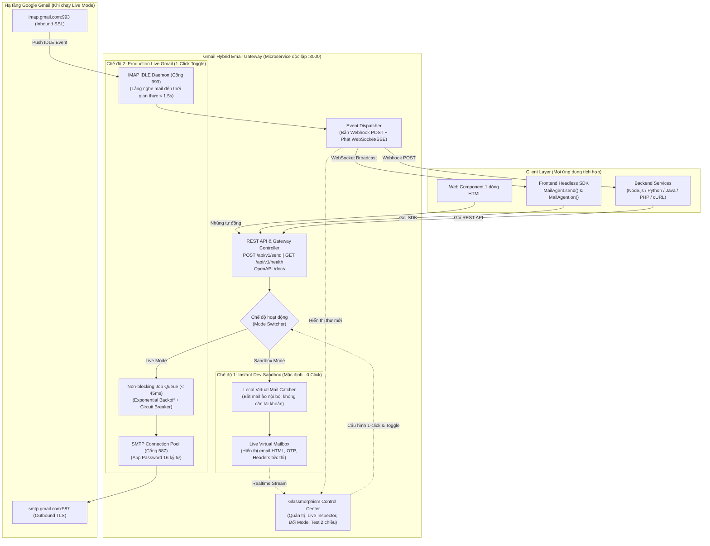

# FINAL IMPLEMENTATION PLAN: HYBRID EMAIL-AS-A-SERVICE GATEWAY (SOA ARCHITECTURE)

> **Dự án:** Gmail SMTP Service Hub (Seminar Học phần SOA)  
> **Định vị sản phẩm:** Nền tảng **"Private Email Gateway"** đa năng, cung cấp dịch vụ Email 2 chiều (Gửi & Nhận) cho mọi ứng dụng với **trải nghiệm nhúng 1 dòng lệnh (Bootstrap-style)**, **0 cấu hình ban đầu (Zero-click Sandbox)** và hiệu năng cao chuẩn Microservice.

---

## 1. SƠ ĐỒ KIẾN TRÚC TỔNG THỂ (HYBRID DUAL-MODE SOA GATEWAY)



---

## 2. TRẢI NGHIỆM TÍCH HỢP ĐỘT PHÁ (DX SPECIFICATION)

###  Cách 1: Nhúng Web Component (Chuẩn 1 dòng giống Bootstrap)
Dành cho bất kỳ trang web nào (Landing Page, Form Liên hệ, Đăng ký nhận tin) mà **không cần viết 1 dòng Javascript hay CSS nào**:

```html
<!-- Dán script duy nhất vào thẻ <head> hoặc trước </body> -->
<script src="http://localhost:3000/embed.js"></script>

<!-- Nhúng widget form liên hệ giao diện Glassmorphism tuyệt đẹp -->
<mail-widget 
    target="support@mydomain.com" 
    title="Gửi Yêu Cầu Hỗ Trợ" 
    theme="glassmorphism" 
    button-text="Gửi Ngay">
</mail-widget>
```
*Tự động có sẵn:* Validation email, hiệu ứng Loading Spinner, Thông báo Success/Error, tự kết nối API Hub!

---

###  Cách 2: Headless SDK 2 chiều cho Web / Frontend SPA
```html
<script src="http://localhost:3000/sdk/mail-agent.min.js"></script>
<script>
  // Chiều GỬI: Phản hồi ngay < 50ms
  MailAgent.send({
    to: "client@example.com",
    subject: "Xác thực tài khoản",
    html: "<h2>Mã kích hoạt của bạn là: 889922</h2>"
  });

  // Chiều NHẬN: Lắng nghe thư mới thời gian thực từ Google
  MailAgent.on('mail:received', function(mail) {
    console.log("Thư mới nhận được từ:", mail.from);
    showNotification("Email mới: " + mail.subject);
  });
</script>
```

---

###  Cách 3: Universal Backend API & Webhook (Mọi ngôn ngữ)
* **Gửi mail (Outbound):** 1 dòng cURL
  ```bash
  curl -X POST http://localhost:3000/api/v1/send \
    -H "Content-Type: application/json" \
    -d '{"to": "dev@soa.edu.vn", "subject": "Test", "text": "Hello SOA"}'
  ```
* **Nhận mail (Inbound):** Khách hàng điền URL Webhook của họ vào Dashboard (ví dụ: `https://my-backend.com/api/mail-webhook`). Khi có mail tới, Gateway tự động `POST` payload JSON đã bóc tách sạch sẽ.

---

## 3. THƯỚC ĐO HIỆU NĂNG & TIÊU CHUẨN THIẾT KẾ SOA

| Tiêu chuẩn Non-functional | Chỉ số cam kết (SLA) | Giải pháp kỹ thuật |
| :--- | :--- | :--- |
| **API Response Latency (Gửi)** | **< 45ms** (trả `202 Accepted`) | Kiến trúc hàng đợi In-Memory Queue, tách biệt khâu nhận request và khâu SMTP handshake. |
| **Sandbox Latency** | **< 20ms** | Local Virtual Mailbox bắt packet ngay trong memory, cập nhật UI qua WebSocket. |
| **Realtime Inbound Latency (Nhận)** | **< 1.5 giây** | Cơ chế socket **IMAP IDLE** (Push-notification từ Google), loại bỏ hoàn toàn polling lãng phí. |
| **Khả năng chịu lỗi (Resiliency)** | Tự phục hồi không mất email | **Exponential Backoff Retry** (3 lần) + **Circuit Breaker** khi chạm hạn mức Gmail. |
| **Bảo mật & Coupling** | Loose Coupling (Kết nối lỏng) | Client không bao giờ nắm mật khẩu Gmail; Gateway tập trung bảo mật bằng JWT/API-Key. |
| **Thời gian Onboarding** | **0 giây** (Sandbox) / **30 giây** (Live) | Khởi động lên dùng được ngay mà không cần tài khoản hay cấu hình ban đầu. |

---

## 4. CHI TIẾT CÁC MODULE TRIỂN KHAI (TASKS BREAKDOWN)

### Phase 1: Core Engine & Dual-Mode Gateway
- [ ] Khởi tạo dự án Node.js với cấu trúc Microservice phân tầng (`src/api`, `src/services`, `src/queue`, `src/public`).
- [ ] Xây dựng **Mode Switcher** quản lý 2 trạng thái: `SANDBOX` (mặc định) và `LIVE_GMAIL`.
- [ ] Module **Local Virtual Mail Catcher**: Lưu trữ thư ảo trong bộ nhớ ram, cho phép inspect header, raw MIME, HTML render mà không cần gửi đi đâu.
- [ ] Module **Nodemailer Live Pool**: Cấu hình kết nối tối ưu với `smtp.gmail.com:587`, pooling kết nối, tự quản lý timeout.
- [ ] Module **Asynchronous Task Queue**: Hàng đợi phi khóa (non-blocking) với cơ chế Retry & Rate Limiting.
- [ ] Chuẩn hóa REST API Endpoints:
  - `POST /api/v1/send` (Gửi mail)
  - `GET /api/v1/health` (Kiểm tra trạng thái hệ thống & SMTP status)
  - `GET /api/v1/mails` (Lấy danh sách thư ảo Sandbox)
  - `POST /api/v1/config/mode` (Chuyển đổi Sandbox <-> Live)

### Phase 2: Inbound IMAP IDLE & Webhook System
- [ ] Tích hợp `imapflow` kết nối bảo mật tới `imap.gmail.com:993` bằng App Password.
- [ ] Kích hoạt daemon **IMAP IDLE** lắng nghe event `exists` (thư mới) theo thời gian thực.
- [ ] Tích hợp `mailparser` để bóc tách luồng thư: người gửi, người nhận, tiêu đề, nội dung text/html, file đính kèm.
- [ ] Module **Webhook Dispatcher**: Tự động bắn HTTP POST payload tới các URL đã đăng ký.
- [ ] Module **WebSocket / SSE Gateway**: Kênh bắn tin tức thì về Dashboard và Client SDK.

### Phase 3: Client SDK & 1-Line Web Component Widget
- [ ] Xây dựng file `embed.js` chứa Web Component `<mail-widget>`:
  - Tự sinh form giao diện Glassmorphism cực đẹp.
  - Tự validate form (empty, email format).
  - Tự động gọi API của Gateway và hiển thị feedback animation.
- [ ] Xây dựng file `mail-agent.min.js`:
  - Thư viện JS nhỏ gọn (< 8KB) cung cấp hàm `MailAgent.send()` và `MailAgent.on()`.

### Phase 4: Control Center Dashboard (Giao diện Quản trị & Sandbox Inspector)
- [ ] Thiết kế Single Page Dashboard (HTML/CSS/JS thuần hiện đại, Glassmorphism, Dark/Light Mode):
  - **Live Virtual Mailbox:** Hiển thị danh sách email nhận được (cả Sandbox lẫn Inbound Gmail), xem trước responsive (Desktop/Mobile), xem mã nguồn HTML và OTP.
  - **Status Bar & Mode Toggle:** Công tắc gạt chuyển đổi `[Sandbox Mode]` <---> `[Live Gmail Mode]`.
  - **Setup Wizard:** Form nhập Email + App Password (kèm hình minh họa 3 bước lấy mật khẩu 16 ký tự của Google).
  - **Interactive Code Generator:** Tab hướng dẫn tích hợp, tự động sinh code 1 dòng (HTML Web Component, JavaScript, Node.js, Python, cURL).
  - **Webhook Manager:** Quản lý danh sách URL webhook nhận thư.

### Phase 5: Tự động hóa & Kịch bản Demo Seminar
- [ ] Viết file `start.bat` (Windows) và `start.sh` (Linux/Mac): 1 click tự kiểm tra Node.js, cài package nếu thiếu và mở trình duyệt vào Dashboard.
- [ ] Viết `Dockerfile` và `docker-compose.yml`.
- [ ] Xây dựng **Demo Page (`demo.html`)**: Trang web giả lập dự án khách hàng nhúng `<mail-widget>` và SDK để trình chiếu trực tiếp trong buổi seminar.
- [ ] Soạn tài liệu thuyết trình & Slide outline phân tích ưu thế kiến trúc SOA.

---

## 5. CẤU TRÚC THƯ MỤC DỰ ÁN DỰ KIẾN (`GmailSMTP/`)

```
d:/STUDY/SOA/Seminar/GmailSMTP/
├── src/
│   ├── api/                   # REST API Controllers & Routes
│   │   ├── mail.controller.js
│   │   ├── config.controller.js
│   │   └── webhook.controller.js
│   ├── core/                  # Xử lý Logic lõi
│   │   ├── mode-manager.js    # Quản lý chế độ Sandbox vs Live
│   │   ├── smtp-live.js       # Driver gửi Gmail SMTP
│   │   ├── imap-listener.js   # Driver nhận Gmail IMAP IDLE
│   │   ├── sandbox-store.js   # Bộ nhớ lưu mail ảo Sandbox
│   │   ├── queue.js           # Hàng đợi gửi mail async
│   │   └── webhook-dispatcher.js # Bắn webhook ra ngoài
│   ├── public/                # Dashboard & Client Assets
│   │   ├── index.html         # Glassmorphism Control Center Dashboard
│   │   ├── app.js             # Logic Dashboard & WebSocket listener
│   │   ├── style.css          # Giao diện hiện đại
│   │   ├── embed.js           # Web Component <mail-widget> 1 dòng
│   │   └── mail-agent.min.js  # Headless Client SDK
│   ├── demo/                  # Trang web mẫu tích hợp demo seminar
│   │   └── index.html         # Demo nhúng widget & nhận mail realtime
│   └── server.js              # Entrypoint chính của Gateway
├── package.json
├── start.bat                  # 1-Click launcher cho Windows
├── Dockerfile
└── README.md                  # Hướng dẫn chi tiết & kịch bản thuyết trình
```
